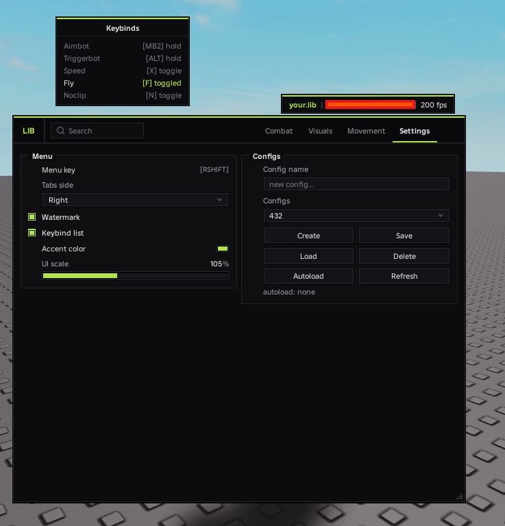

# skeet-like

CS:GO cheat style UI library for Roblox — dark panels, double borders, groupboxes, accent line, smooth animations.



## Features

- Tabs (left or right side), two-column groupboxes, search
- Toggles with keybinds (Hold / Toggle / Always), color pickers and extra settings popup (gear)
- Sliders with manual value input, dropdowns, textboxes, buttons, key pickers, labels
- Watermark and keybind list (draggable)
- Configs: create / save / load / delete / autoload, custom folder
- Live accent color, UI scale, resizable window
- Built-in Roblox fonts or custom fonts loaded from a URL
- Notifications

## Loading

```lua
local Lib = loadstring(game:HttpGet("https://raw.githubusercontent.com/aisisi-hui/libs/refs/heads/main/skeet-like/Library.lua"))()
```

Full example: [`Example.lua`](Example.lua)

## Window

```lua
local Window = Lib:CreateWindow({
	Title = "LIB",                          -- logo in the top bar
	Name = "my.hub",                        -- name in the watermark
	Accent = Color3.fromRGB(180, 227, 74),
	MenuKey = Enum.KeyCode.RightShift,      -- open / close
	TabsSide = "Right",                     -- "Left" | "Right"
	Size = Vector2.new(600, 500),
	Font = "BuilderSans",                   -- see Fonts
	ConfigFolder = "MyHub/GameName",        -- configs, fonts, autoload
})
```

| Method | |
|---|---|
| `Window:AddTab(name)` | new tab |
| `Window:AddSettingsTab()` | ready-made Settings tab (menu key, tabs side, watermark, keybind list, accent, UI scale, configs). Call it **last** |
| `Window:SetAccent(Color3)` | change accent |
| `Window:SetOpen(bool)` / `Window:Toggle()` | show / hide |
| `Window:SetSize(Vector2)` | resize (or drag the bottom-right corner) |
| `Window:SetTabsSide("Left" \| "Right")` | move tabs |
| `Window:SetScale(number)` | UI scale, `1` = 100% |
| `Window:SetWatermarkVisible(bool)` | |
| `Window:SetKeybindListVisible(bool)` | |
| `Window:Notify(title, text, duration)` | notification in the bottom-right corner |
| `Window:Destroy()` | unload everything |

## Groups

```lua
local Tab = Window:AddTab("Combat")
local Group = Tab:AddGroup("Aimbot", "Left") -- "Left" | "Right"
```

## Elements

### Toggle

```lua
local Toggle = Group:AddToggle({
	Name = "Enabled",
	Default = true,
	Flag = "aim_enabled",
	Callback = function(value) end,
})

Toggle:Set(false)
Toggle:Get()
Toggle:IsActive() -- toggle is on AND keybind is active (if it has one)
```

#### Keybind

Left click — rebind (Esc cancels, Backspace clears). Right click — mode menu.

```lua
local Bind = Toggle:AddKeybind({
	Default = Enum.KeyCode.F,     -- or Enum.UserInputType.MouseButton2
	Mode = "Hold",                -- "Hold" | "Toggle" | "Always"
	ShowInList = true,
	Callback = function(active) end,
})

Bind.Active
Bind:SetKey(Enum.KeyCode.G)
Bind:SetMode("Toggle")
```

#### Color

```lua
local Color = Toggle:AddColor({
	Default = Color3.new(1, 1, 1),
	Flag = "aim_color",
	Callback = function(color) end,
})
```

#### Extra settings (gear popup)

```lua
local Extra = Toggle:AddSettings()
Extra:AddToggle({ Name = "Prediction" })
Extra:AddSlider({ Name = "Amount", Min = 0, Max = 100, Default = 35, Suffix = "%" })
```

`Extra` supports every element below.

### Slider

```lua
Group:AddSlider({
	Name = "FOV",
	Min = 0,
	Max = 360,
	Default = 90,
	Decimals = 0,
	Suffix = "°",
	Flag = "aim_fov",
	Callback = function(value) end,
})
```

Click the value to type it in.

### Dropdown

```lua
local Dropdown = Group:AddDropdown({
	Name = "Target part",
	Options = { "Head", "Torso", "Closest" },
	Default = "Head",
	Flag = "aim_part",
	Callback = function(value) end,
})

Dropdown:SetOptions({ "A", "B" })
```

### Button / Buttons

```lua
Group:AddButton({ Name = "Rejoin", Callback = function() end })

Group:AddButtons({
	{ Name = "Save", Callback = function() end },
	{ Name = "Load", Callback = function() end },
})
```

### Textbox

```lua
Group:AddTextbox({
	Name = "Player",
	Placeholder = "username...",
	Flag = "target_name",
	Callback = function(text, enterPressed) end,
})
```

### Color row

```lua
Group:AddColor({ Name = "Sky color", Default = Color3.new(0, 0.5, 1), Callback = function(color) end })
```

### Key picker

A plain keybind without the mode menu.

```lua
Group:AddKeyPicker({ Name = "Panic key", Default = Enum.KeyCode.End, Callback = function(key) end })
```

### Label

```lua
local Label = Group:AddLabel("some text")
Label:SetText("new text")
```

## Flags

Every element with a `Flag` is available in `Lib.Flags` and is saved to configs.

```lua
Lib.Flags.aim_fov:Set(120)
print(Lib.Flags.aim_enabled.Value)
```

## Configs

The Settings tab already has a full config UI. From code:

```lua
Lib:SaveConfig("legit")
Lib:LoadConfig("legit")
Lib:DeleteConfig("legit")
Lib:ListConfigs()
Lib:SetAutoload("legit")
Lib:GetAutoload()
```

Configs store every flag plus window size/position and watermark/keybind list positions.

Folder layout:

```
<ConfigFolder>/
  configs/<name>.json
  fonts/
  autoload.txt
```

Requires `writefile`, `readfile`, `isfile`, `isfolder`, `makefolder`, `listfiles`, `delfile`.

## Fonts

Built-in Roblox fonts: `BuilderSans` (default), `Roboto`, `Montserrat`, `Ubuntu`, `SourceSansPro`, `RobotoMono` and others.

Presets that are downloaded on first run: `Inter`, `ProggyClean`.

Any `.ttf` / `.otf` by URL:

```lua
Lib:CreateWindow({
	Font = { Name = "MyFont", Regular = "https://.../MyFont-Regular.ttf", Bold = "https://.../MyFont-Bold.ttf" },
})
```

Custom fonts need `writefile` and `getcustomasset`; otherwise the library falls back to `BuilderSans`.

## Customization

Set before `CreateWindow`:

```lua
Lib.MinSize = Vector2.new(480, 340)
Lib.MaxSize = Vector2.new(900, 680)
Lib.Icons.Search = "rbxassetid://..."
Lib.Icons.Settings = "rbxassetid://..."
Lib.Icons.ChevronDown = "rbxassetid://..."
```

Icons are [Lucide](https://lucide.dev): `search`, `settings`, `chevron-down`.
